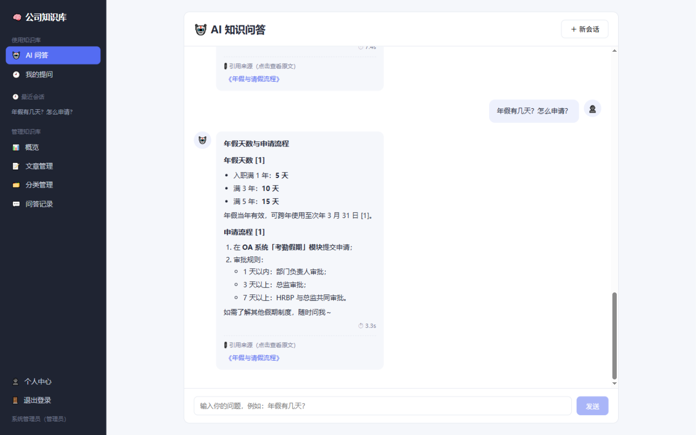
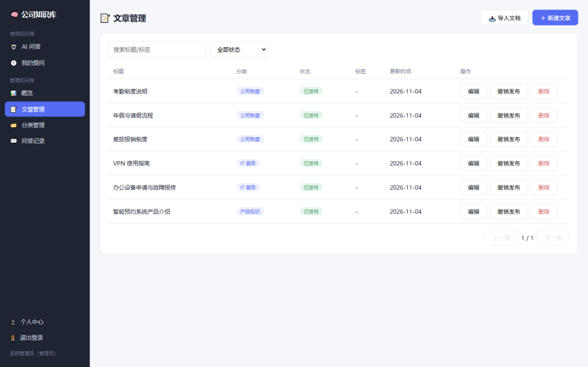
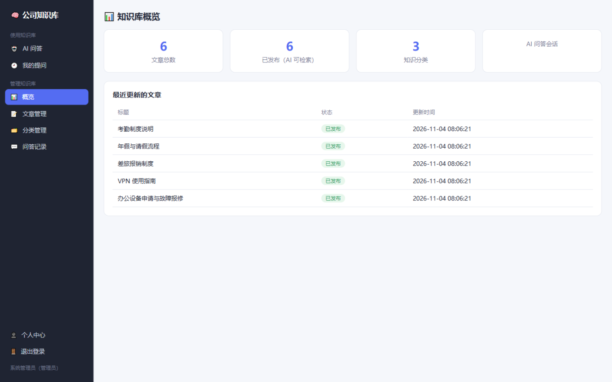
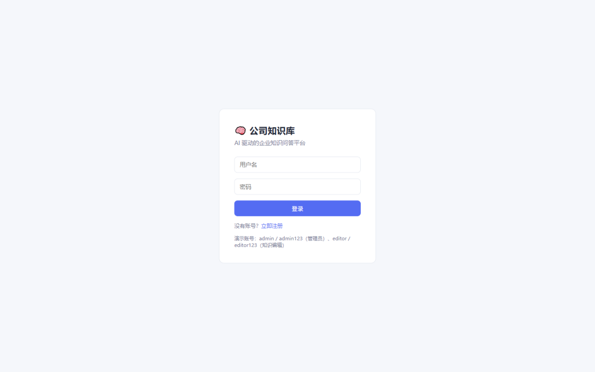

# kb-assistant-agent 企业智能知识库

基于 **RAG + AI Agent** 的公司知识库系统：用户用自然语言提问，智能体检索知识库并生成带引用来源的回答；公司编辑可管理知识文章，发布即自动向量化入库，支持 PDF / Word / TXT / Markdown 文档导入。

> 技术栈覆盖：FastAPI · LangGraph Workflow · Function Calling / Tool Calling · RAG（结构感知切片 + Chroma + BGE 嵌入 + 相关性阈值过滤）· Prompt / Context Engineering · SSE 流式输出 · JWT 多角色权限 · Docker 部署

📚 **新手教程**：[docs/TUTORIAL.md](docs/TUTORIAL.md) —— 从零到一 15 步还原整个项目的搭建过程，每步含原理讲解、核心代码与验证方式，附真实踩坑清单。

## 界面预览

| AI 知识问答（带引用溯源） | 文章管理（分类/状态/导入） |
|---|---|
|  |  |

| 管理端概览 | 登录 |
|---|---|
|  |  |

## 核心能力

- **AI 问答 + 引用溯源**：LangGraph ReAct 工作流，DeepSeek/GLM 自主调用工具（检索/查全文/列分类），回答附引用来源并可点击查看原文
- **强制预检索**：每个问题先静默向量检索一次注入上下文（Context Engineering），模型只需决定"用不用"而非"查不查"，杜绝漏检索
- **结构感知切片**：按 Markdown 标题层级 → 段落 → 句子边界递归切分；章节边界零重叠，句子级细分仅保留 ~15% 重叠；每个切片携带文章 ID / 章节路径 / 分类等元数据
- **检索去噪**：cosine distance 阈值过滤不相关切片；引用来源按文章去重
- **文档导入**：PDF（pypdf）/ Word（python-docx）/ TXT / MD 上传，提取文本→切片→向量化一步完成
- **多角色权限**：`user`（提问）/ `editor`（知识编辑，管理文章、分类、查看问答记录）/ `admin`（系统管理员）
- **多轮会话**：会话历史持久化，跨页面切换不丢失，历史可回看与删除
- **运维可观测**：SSE 实时推送检索/工具调用状态，Swagger 在线调试，健康检查

## 架构

```
fronted/  Vue 3 + vue-router（用户问答端 + 管理端，按角色渲染菜单，移动端响应式）
backend/
├── app/
│   ├── agent/        # LangGraph 工作流 + Function Calling 工具集 + GLM 客户端
│   ├── services/     # rag.py（切片/向量库/检索）、doc_parser.py（文档解析）
│   ├── prompts.py    # Prompt Engineering：角色边界、防幻觉约束、上下文块拼装
│   ├── routers/      # auth / users / categories / articles(含导入) / chat(SSE)
│   ├── models/       # User / Category / Article / ChatSession / ChatMessage
│   └── utils/        # JWT、统一响应、角色依赖注入
├── chroma_data/      # Chroma 向量库持久化
└── Dockerfile
docker-compose.yml    # 前端(Nginx 反代 SSE) + 后端 + 卷持久化
```

**问答链路**：提问 → 强制预检索（BGE-m3 向量召回 + 阈值过滤）→ 上下文注入 → LangGraph Agent（GLM，`bind_tools`）→ 按需调用工具补充检索 → 流式生成（SSE）→ 落库会话与引用

## 快速开始

### 后端（端口 8001）

```bash
cd backend
cp .env.example .env        # 填入 GLM_API_KEY（智谱/Z.ai）与 SILICONFLOW_API_KEY（硅基流动）
python -m venv venv && venv\Scripts\pip install -r requirements.txt   # Windows
uvicorn app.main:app --host 0.0.0.0 --port 8001
```

首次启动自动建表、创建默认账号并写入种子文章（发布文章会自动向量化）：

| 账号 | 密码 | 角色 |
|---|---|---|
| admin | admin123 | 管理员 |
| editor | editor123 | 知识编辑 |

- Swagger 文档：http://localhost:8001/docs
- `.env` 关键项：`GLM_BASE_URL`（智谱开放平台 `https://open.bigmodel.cn/api/paas/v4`，Z.ai Coding Plan 用 `https://api.z.ai/api/coding/paas/v4`）、`RAG_MAX_DISTANCE`（检索相关性阈值，默认 0.75）、`CHUNK_SIZE`（切片大小，默认 500）

### 前端（端口 5174/5175）

```bash
cd fronted
npm install
npm run dev
```

访问 http://localhost:5174/ （端口被占用时自动顺延，以控制台输出为准）。

### Docker 一键部署

```bash
docker compose up -d     # 前端 5174→80，后端 8001，向量库/数据库卷持久化
```

## API 一览

| 模块 | 端点 | 说明 |
|---|---|---|
| 认证 | `POST /api/auth/register` `/login` `/token` | 注册/登录，JWT |
| 问答 | `POST /api/chat/ask` | SSE 流式问答（chunk/tool/sources/done 事件） |
| 会话 | `GET /api/chat/sessions` `/sessions/{id}` `DELETE ...` | 历史/详情/删除 |
| 文章 | `GET/POST/PUT/DELETE /api/articles`，`POST /{id}/publish` `/unpublish` | 管理端 CRUD，发布即向量化 |
| 导入 | `POST /api/articles/import` | multipart，PDF/DOCX/TXT/MD |
| 分类 | `GET/POST/DELETE /api/categories` | 分类管理 |
| 记录 | `GET /api/chat/records` | 问答记录（editor/admin，分页） |

## 测试账号与数据

种子数据含 3 个分类（公司制度 / IT 服务 / 产品知识）和 6 篇示例文章；知识库检索、文档导入、发布、问答全链路均可离线验证（未配置 API Key 时问答会返回明确提示）。
